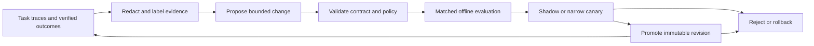

# Evolution: evidence, experiments, promotion, rollback

Teamagent should improve procedures, retrieval, routing, and model configuration through a controlled experimental loop. The active system remains versioned and reproducible while a separate process proposes changes from traces. The strongest observed patterns are durable evidence, explicit candidate generation, independent evaluation, narrow canaries, and reversible promotion. No reviewed repository demonstrates a universally best self-improving team harness across this task's full requirements.

Scope: static source/content analysis as of 2026-10-04, plus spot checks of primary upstream pages. The linked reports distinguish implemented code, documentation claims, and Teamagent design recommendations. Related directions: [skills](skills.md), [memory](memory.md), [decisions](decisions.md), [agents](agents.md), [models](models.md), and [import and generation](import-generation.md).

## 1. A durable improvement loop

[Autoharness][gh-auto] ([report][r-auto]) implements the useful boundary between a proposing model and a deterministic writer. It records evidence and archives skills according to exposure/use. Its source also marks thresholds as placeholders and acknowledges concurrency/crash-accounting limitations. Borrow the boundary, not an assumption that frequently loaded skills are better.

[Everything Claude Code][gh-ecc] ([report][r-ecc]) describes atomic instincts before clustering into skills, with project scope and confidence. Use atomic lessons as hypotheses. A correction such as “this repository uses a different migration command” is a scoped assertion with evidence, not a reason to rewrite global behavior. Store who observed the lesson, what task it came from, applicable versions, contradictory evidence, and whether the user explicitly stated it or a model inferred it.

The mutation service accepts a typed proposal: target object/version, bounded diff, expected benefit, evidence IDs, affected tasks, required capabilities, estimated evaluation cost, and rollback digest. It validates scope and content before creating any active binding. Models can propose changes; policy services enforce allowed effects and state transitions.

## 2. Optimize the right layer

| Layer | Candidate changes | Typical verifier | Main failure risk |
|---|---|---|---|
| Knowledge | Extraction correction, freshness, supersession, chunking | Source-span fidelity, retrieval fixtures | False facts becoming persistent memory |
| Retrieval | Filters, lexical/semantic fusion, reranker, context budget | Relevance/coverage and end-task success | More retrieved text reducing useful context |
| Skills | Trigger, examples, references, decomposition, tool sequence | Trigger negatives plus artifact outcome | Overactivation and workflow overfitting |
| Routing | Agent/model, worker count, retry/escalation threshold | Matched task outcome, latency, cost | Selection bias and hidden downstream spend |
| Harness | State machine, tool schema, compaction, scheduler | Integration and failure-recovery suites | Broad regressions and permission changes |
| Weights | Distillation, adapter training, pruning | Held-out task and capability suites | Lost rare capabilities and expensive retraining |

Use the cheapest layer likely to solve the measured failure. Many failures are missing evidence, wrong tool contracts, or poor state handling, which do not require model training. [Rearchitecting LLMs][gh-rearch] ([report][r-rearch]) is a useful educational reference for a later specialized local-model program, but its notebooks and helpers are not a production harness or a guarantee that structural changes preserve tool-use quality.

Keep quality and efficiency multi-dimensional. A shorter prompt that passes fewer tasks is not automatically an improvement, nor is a higher judge score obtained by tripling cost. Decisions should compare expected user outcome, tail latency, actual or estimated spend, privacy constraints, and operational risk through [decisions](decisions.md).

## 3. Evaluation matrix and scorecard

The basic evaluation unit is a complete configuration: model revision, harness/adapter revision, system policy, skill digests, retrieval/index snapshot, tools, runtime image, task input, budgets, network policy, and evaluator version. Save raw events and produced artifacts so accounting or scoring can be corrected without rerunning the model.

[FrontierHarness Eval][gh-frontier] ([report][r-frontier]) demonstrates frozen task manifests, canonical run selection, retained evidence, cost coverage, and an explicit comparability flag. Its source says new runs need a matched control because historical baseline egress policy was not recorded. This is a valuable warning against transferring leaderboard rankings into Teamagent's defaults.

| Workload | Primary outcome | Additional dimensions |
|---|---|---|
| Coding | Independent tests, acceptance checks, regression status | Diff quality, review defects, time, retries, tool effects |
| Knowledge query | Correct answer and valid supporting citations | Retrieval coverage, faithfulness, freshness, contradictions |
| Import | Faithful normalized content with provenance | Missing pages/images, parser errors, duplicate handling |
| Media/artifacts | Required file exists and satisfies content/layout criteria | Human preference, rendering, reproducibility, generation cost |
| Agent orchestration | Task completion under retries/interruption | Duplicate effects, lost work, cancellation, ownership conflicts |
| Skill selection | Correct positive activation and near-miss rejection | Context cost, marginal outcome benefit, denied capabilities |
| Channels | Correct routing and durable conversation state | Delivery duplication, latency, identity isolation |

[Ragas][gh-ragas] ([report][r-ragas]) provides a concrete faithfulness mechanism: statement decomposition and support judgments against retrieved context. It measures evidence consistency, not absolute truth, and its empty-statement path returns NaN. Preserve unknown/invalid scores and coverage. Use citation existence and deterministic checks before expensive judges. Calibrate judges against human-labeled cases and include source contradictions rather than assuming retrieved evidence is always reliable.

[LangWatch][gh-langwatch] ([report][r-langwatch]) provides a useful reference for attaching evaluations to trace graphs and preventing recursive evaluation loops. The inspected service grants evaluators internal access to captured data, so a redacted UI is not proof of redacted evaluation input. Export and judge access need explicit data scopes, retention, and model-provider constraints.

## 4. Experimental design that resists self-deception

Split datasets by task family, repository lineage, customer/tenant where relevant, and time. Near-duplicate issues or copied repositories must remain in one partition. Use development data for proposals, validation data for selection, and a locked test set for final estimates. Keep a small private holdout to detect adaptation to public benchmarks. Log every trial, including failures and abandoned candidates.

Use paired comparisons on the same task/environment, randomize ordering where cache or load can matter, and repeat stochastic tasks. Report differences with uncertainty and per-slice outcomes. A broad mean can hide regressions for local models, Windows paths, large files, multilingual prompts, or low-connectivity operation. Distinguish infrastructure failures from task failures while reporting their frequency and total cost. Predeclare a trials budget and a stopping rule so repeated searching does not manufacture a winner.

[Agent Skills][gh-spec] ([report][r-spec]) supplies with/without-skill and prior-version comparisons plus near-miss trigger tests. [Superpowers][gh-superpowers] ([report][r-superpowers]) provides a failure-first skill-authoring method. Adapt both into controlled experiments, avoiding the mistake of scoring compliance with a procedure as if it were the desired task outcome.

Benchmark labels must describe their evidence. [Schema Harness][gh-schema] ([report][r-schema]) is a static launch-site repository whose article explicitly calls its public results self-reported and declines a held-out claim. Its reported score also retains the better result from paired model runs. Use its history-backed program-model concept as a research idea; do not portray the article's public-game score as a reproduced general harness capability.

## 5. Candidate search and model-specific tuning

Begin with deterministic fixes and small ablations: remove redundant instructions, add a missing example, change a retrieval filter, or repair a tool schema. Compare each change with the unchanged baseline. A search service can then explore descriptions, demonstrations, decomposition choices, context budgets, and routing thresholds under strict bounds.

[DSPy][gh-dspy] ([report][r-dspy]) contributes metric-driven program optimization and GEPA-style feedback-based search. The inspected path defaults validation to training data when no validation set is supplied and emits an overfitting warning, so the evaluation service must require an explicit split. [Agent-Opt][gh-opt] ([report][r-opt]) uses Optuna over few-shot count and seeded selection; its inspected path draws examples and scores from the supplied dataset, likewise requiring externally enforced held-out evaluation.

[MetaHarness][gh-metaharness] ([report][r-metaharness]) contributes bounded harness search with scope/class/leakage filtering and validate/evaluate stages. Optional leakage checks must become required policy for Teamagent's release experiments where applicable. Keep optimization workers away from hidden expected answers and production secrets. A candidate's access to a verifier should expose the permitted score/feedback contract, not the final test answers.

For each search, store configuration space, optimizer and teacher versions, initial candidates, budget, dataset hashes, generated diffs, trial outcomes, and selection rationale. Benchmark random search or simple manual alternatives before assuming a sophisticated optimizer is cost-effective. Any tuned variant retains the original task contract and a source/parent lineage. A stronger model can propose a compact skill for a smaller model, but the smaller model must be the evaluated executor.

## 6. Decision learning and value of experiments

A proposed policy chooses an experiment when its expected reduction in future decision loss exceeds its cost and delay. Useful actions include retrieving evidence, running a diagnostic, asking for missing information, trying a stronger model, spawning an independent reviewer, or comparing two skill variants. Estimate benefit from similar task slices and preserve uncertainty. This is a Teamagent decision design, not a claimed implementation in all reviewed repositories.

Use contextual bandits only after stable instrumentation exists and constrain exploration to reversible, policy-compliant choices. Log the action set and selection propensity so later analysis can recognize selection bias. Reserve randomization or matched controls for assessing causal benefit. Do not infer that the cheapest model causes failures merely because it was assigned harder tasks, or that a rare skill is worthless because its trigger was never exposed.

[Schema Harness][gh-schema] ([report][r-schema]) suggests a narrower useful idea: build an executable hypothesis, backtest against all observed transitions, and use it for low-cost planning. Apply this where a simulator or reproduction is available. Historical consistency does not establish correctness on unseen states, so include counterexample search, predictive checks, and fallback to direct observation. The [decisions](decisions.md) document defines how this connects to the requested JEV-like approach.

## 7. Promotion, canary, and retirement

Promotion is a deterministic state machine with evidence-bearing transitions:

1. **Candidate:** immutable proposal with source and parent digest.
2. **Validated:** schema, capabilities, scope, dependency and policy checks pass.
3. **Evaluated:** representative held-out comparisons satisfy predeclared slice constraints.
4. **Shadow:** eligible tasks record hypothetical selection; execution has no production effects.
5. **Canary:** narrowly scoped activation with explicit budget and a baseline cohort where practical.
6. **Active:** accepted revision with rollback pointer and ongoing monitoring.
7. **Deprecated/archive:** unavailable to new tasks but retained for historical trace interpretation.

Quality gates should be chosen from task risk and measurement uncertainty. Initial examples are “no deterministic safety regression” and “no statistically credible degradation on a required task slice”; do not invent universal score thresholds. Privileged capability or global policy changes require the applicable owner policy independently of an evaluation win. User-authored rules and user preferences remain separate from inferred optimizations.

[Autoharness][gh-auto] ([report][r-auto]) uses probation and exposure-normalized usage for lifecycle decisions. Improve this with verified success benefit, retrieval coverage, age/freshness, and explicit protected rare procedures. [Everything Claude Code][gh-ecc] ([report][r-ecc]) uses confidence and cross-project promotion heuristics; require independent project evidence and real outcomes instead of treating these values as calibrated certainty. Archive reversible candidates rather than erasing their evidence.

Rollback should restore a whole versioned binding: skill variants, selector policy, compatible tool schema, and any affected index version. In-flight tasks retain their starting snapshot unless an urgent policy revocation requires stopping them. A rollback event records the regression, affected run IDs, and the restored digest. Immutable raw observations must not be rewritten to make the earlier policy look successful.

## 8. Telemetry and accounting

The event schema needs task/run/parent IDs, model/provider/harness versions, skill digests, source evidence, tool calls, approvals/denials, artifact references, outcome verifiers, and resource use. Capture inputs/outputs only under the configured privacy policy; preserve a normalized nonsecret event path for local/cloud comparison.

[ccusage][gh-ccusage] ([report][r-ccusage]) demonstrates provider-specific compaction and fork-replay accounting. [Codeburn][gh-codeburn] ([report][r-codeburn]) demonstrates cross-agent tool/skill attribution with inferred fields. Reconcile live and historical events by stable identities, label estimates, and retain parser versions. Unknown tokens, unknown price, and absent outcome are not zero.

Separate observed tokens, listed API-equivalent price, billed API spend, fixed subscription allocation, quota availability, and local compute cost. A subscription route may have low immediate marginal cash cost but scarce quota or higher latency. Evaluators, reflectors, importers, rerankers, and media generation must receive their own cost records under the parent task. Otherwise optimization can shift spending outside the visible model call and appear artificially efficient.

## 9. Specification and artifact evolution

[OpenSpec][gh-openspec] ([report][r-openspec]) supplies a dependency-graph model for artifacts. [Spec Kit][gh-speckit] ([report][r-speckit]) separates specification/checklist workflow from implementation status. [Get Shit Done][gh-gsd] ([report][r-gsd]) emphasizes compact coordination and wave-based work with durable summaries. Use these patterns to keep requirements, accepted decisions, code changes, and test results connected.

A changed requirement invalidates affected tests, plans, and learned procedures through explicit dependency edges. A completed file is not necessarily a verified artifact. Preserve old revisions for explaining historical choices, expose the current accepted state for queries, and mark stale derived memory until revalidated. [Trail of Bits][gh-tob] ([report][r-tob]) is a useful model for preserving unresolved assumptions and disagreements in code-analysis artifacts instead of silently converting them into facts.

## 10. Delivery sequence and acceptance

First deliver normalized events, immutable configuration snapshots, a task dataset, and deterministic verifiers. Then add selected model judges, candidate skill proposals, paired evaluations, and manual reviewable promotion. Next add bounded automated search, shadow selection, canaries, and automatic rollback. Weight training and advanced online learning follow only when stable volume and measured opportunity justify them.

Acceptance requires reproducible task/configuration identity; independent train/validation/test separation; complete trial accounting; explicit unknown-score coverage; no evaluator recursion; tenant/project isolation; observed versus inferred telemetry labels; a working rollback exercise; and demonstrable improvement on the team's tasks without violating required slices. Performance remains unmeasured until this evaluation program runs.

[gh-auto]: https://github.com/tigerless-labs/autoharness
[r-auto]: projects/ai-agents-skills--evolve-claude.autoharness.md
[gh-ecc]: https://github.com/affaan-m/everything-claude-code
[r-ecc]: projects/ai-skills--bundle-claude.ecc.affaan-m.md
[gh-rearch]: https://github.com/peremartra/Rearchitecting-LLMs
[r-rearch]: projects/ai-info--rearchitecting-llms.md
[gh-frontier]: https://github.com/frontier-harness-eval/eval
[r-frontier]: projects/ai-eval--frontier-harness-eval.md
[gh-ragas]: https://github.com/vibrantlabsai/ragas
[r-ragas]: projects/ai-eval--xx-2602-ragas.md
[gh-langwatch]: https://github.com/langwatch/langwatch
[r-langwatch]: projects/ai-eval--langwatch.md
[gh-spec]: https://github.com/agentskills/agentskills
[r-spec]: projects/ai-agents-skills--docs.skills.md
[gh-superpowers]: https://github.com/obra/superpowers
[r-superpowers]: projects/ai-skills--plan.obra-superpowers.md
[gh-schema]: https://github.com/schema-harness/schema-harness.github.io
[r-schema]: projects/ai-info--game-schema-harness.md
[gh-dspy]: https://github.com/stanfordnlp/dspy
[r-dspy]: projects/ai-agents--dspy.md
[gh-opt]: https://github.com/future-agi/agent-opt
[r-opt]: projects/ai-prompts--xx-2604-agent-opt.md
[gh-metaharness]: https://github.com/SuperagenticAI/metaharness
[r-metaharness]: projects/ai-agents--metaharness.md
[gh-ccusage]: https://github.com/ryoppippi/ccusage
[r-ccusage]: projects/ai-agents-tokens--ccusage.md
[gh-codeburn]: https://github.com/getagentseal/codeburn
[r-codeburn]: projects/ai-agents-tokens--codeburn.md
[gh-openspec]: https://github.com/Fission-AI/OpenSpec
[r-openspec]: projects/ai-spec--openspec.md
[gh-speckit]: https://github.com/github/spec-kit
[r-speckit]: projects/ai-spec--spec-kit.md
[gh-gsd]: https://github.com/gsd-build/get-shit-done
[r-gsd]: projects/ai-spec--get-shit-done.md
[gh-tob]: https://github.com/trailofbits/skills
[r-tob]: projects/ai-skills--security.trailofbits.md

<!-- coverage:start -->
## Project coverage

Every associated project has its own report. Source-reviewed associations reflect the inspected scope; screened associations derive from the input category and are not capability claims.

| Source | Report | Depth |
|---|---|---|
| [dspy](https://github.com/stanfordnlp/dspy) | [Report](projects/ai-agents--dspy.md) | source-reviewed |
| [gascity](https://github.com/gastownhall/gascity) | [Report](projects/ai-agents--gascity.md) | source-reviewed |
| [metaharness](https://github.com/SuperagenticAI/metaharness) | [Report](projects/ai-agents--metaharness.md) | source-reviewed |
| [mini-swe-agent](https://github.com/SWE-agent/mini-swe-agent) | [Report](projects/ai-agents--mini-swe-agent.md) | source-reviewed |
| [paperclip](https://github.com/paperclipai/paperclip) | [Report](projects/ai-agents--paperclip.md) | source-reviewed |
| [agent-beacon](https://github.com/Asymptote-Labs/agent-beacon) | [Report](projects/ai-agents-mem--agent-beacon.md) | screened |
| [agent-memory-techniques](https://github.com/NirDiamant/Agent_Memory_Techniques) | [Report](projects/ai-agents-mem--agent-memory-techniques.md) | screened |
| [agent-memory.neo4j](https://github.com/neo4j-labs/agent-memory) | [Report](projects/ai-agents-mem--agent-memory.neo4j.md) | screened |
| [agentmemory](https://github.com/rohitg00/agentmemory) | [Report](projects/ai-agents-mem--agentmemory.md) | screened |
| [bbolt](https://github.com/etcd-io/bbolt) | [Report](projects/ai-agents-mem--bbolt.md) | screened |
| [beads](https://github.com/gastownhall/beads) | [Report](projects/ai-agents-mem--beads.md) | screened |
| [bs_cortex](https://github.com/novotapeter-bs/bs_cortex) | [Report](projects/ai-agents-mem--bs_cortex.md) | screened |
| [cabinet](https://github.com/hilash/cabinet) | [Report](projects/ai-agents-mem--cabinet.md) | screened |
| [code-review-graph](https://github.com/tirth8205/code-review-graph) | [Report](projects/ai-agents-mem--code-review-graph.md) | screened |
| [codegraph](https://github.com/colbymchenry/codegraph) | [Report](projects/ai-agents-mem--codegraph.md) | screened |
| [cognee](https://github.com/topoteretes/cognee) | [Report](projects/ai-agents-mem--cognee.md) | source-reviewed |
| [cognee-rs](https://github.com/topoteretes/cognee-rs) | [Report](projects/ai-agents-mem--cognee-rs.md) | screened |
| [commonplace](https://github.com/zby/commonplace) | [Report](projects/ai-agents-mem--commonplace.md) | screened |
| [context-engine](https://github.com/Emmimal/context-engine) | [Report](projects/ai-agents-mem--context-engine.md) | screened |
| [context-engineering-intro](https://github.com/coleam00/context-engineering-intro) | [Report](projects/ai-agents-mem--context-engineering-intro.md) | screened |
| [context-hub](https://github.com/andrewyng/context-hub) | [Report](projects/ai-agents-mem--context-hub.md) | screened |
| [core-memory](https://github.com/JohnnyFiv3r/Core-Memory) | [Report](projects/ai-agents-mem--core-memory.md) | screened |
| [dolt](https://github.com/dolthub/dolt) | [Report](projects/ai-agents-mem--dolt.md) | screened |
| [enterprise-rag-patterns](https://github.com/ashutoshrana/enterprise-rag-patterns) | [Report](projects/ai-agents-mem--enterprise-rag-patterns.md) | screened |
| [flock](https://github.com/whiteducksoftware/flock) | [Report](projects/ai-agents-mem--flock.md) | screened |
| [fokosdb](https://github.com/lambrospetrou/fokosdb) | [Report](projects/ai-agents-mem--fokosdb.md) | screened |
| [gbrain](https://github.com/garrytan/gbrain) | [Report](projects/ai-agents-mem--gbrain.md) | screened |
| [glean-api-go](https://github.com/gleanwork/api-client-go) | [Report](projects/ai-agents-mem--glean-api-go.md) | screened |
| [glean-api-python](https://github.com/gleanwork/api-client-python) | [Report](projects/ai-agents-mem--glean-api-python.md) | screened |
| [glean-api-typescript](https://github.com/gleanwork/api-client-typescript) | [Report](projects/ai-agents-mem--glean-api-typescript.md) | screened |
| [glean-cli](https://github.com/gleanwork/glean-cli) | [Report](projects/ai-agents-mem--glean-cli.md) | screened |
| [glean-configure-mcp](https://github.com/gleanwork/configure-mcp-server) | [Report](projects/ai-agents-mem--glean-configure-mcp.md) | screened |
| [gno](https://github.com/gmickel/gno) | [Report](projects/ai-agents-mem--gno.md) | screened |
| [graft](https://github.com/NanoNets/Graft) | [Report](projects/ai-agents-mem--graft.md) | screened |
| [graphify](https://github.com/safishamsi/graphify) | [Report](projects/ai-agents-mem--graphify.md) | screened |
| [graphiti](https://github.com/getzep/graphiti) | [Report](projects/ai-agents-mem--graphiti.md) | source-reviewed |
| [hindsight](https://github.com/vectorize-io/hindsight) | [Report](projects/ai-agents-mem--hindsight.md) | source-reviewed |
| [honcho](https://github.com/plastic-labs/honcho) | [Report](projects/ai-agents-mem--honcho.md) | screened |
| [lean-ctx](https://github.com/yvgude/lean-ctx) | [Report](projects/ai-agents-mem--lean-ctx.md) | screened |
| [llm-wiki-compiler](https://github.com/atomicmemory/llm-wiki-compiler) | [Report](projects/ai-agents-mem--llm-wiki-compiler.md) | source-reviewed |
| [llm-wiki-v2.rohitg00](https://gist.github.com/rohitg00/2067ab416f7bbe447c1977edaaa681e2) | [Report](projects/ai-agents-mem--llm-wiki-v2.rohitg00.md) | screened |
| [mcp-memory-graphdb](https://github.com/pavex/mcp-memory-graphdb) | [Report](projects/ai-agents-mem--mcp-memory-graphdb.md) | screened |
| [mem0](https://github.com/mem0ai/mem0) | [Report](projects/ai-agents-mem--mem0.md) | source-reviewed |
| [mempalace](https://github.com/milla-jovovich/mempalace) | [Report](projects/ai-agents-mem--mempalace.md) | screened |
| [memvid](https://github.com/memvid/memvid) | [Report](projects/ai-agents-mem--memvid.md) | screened |
| [mentisdb](https://github.com/CloudLLM-ai/mentisdb) | [Report](projects/ai-agents-mem--mentisdb.md) | source-reviewed |
| [my-brain-is-full-crew](https://github.com/gnekt/my-brain-is-full-crew) | [Report](projects/ai-agents-mem--my-brain-is-full-crew.md) | screened |
| [neo4j-graphrag-python](https://github.com/neo4j/neo4j-graphrag-python) | [Report](projects/ai-agents-mem--neo4j-graphrag-python.md) | screened |
| [omnigraph](https://github.com/ModernRelay/omnigraph) | [Report](projects/ai-agents-mem--omnigraph.md) | screened |
| [open-viking](https://github.com/volcengine/OpenViking) | [Report](projects/ai-agents-mem--open-viking.md) | source-reviewed |
| [opencontext](https://github.com/0xranx/OpenContext) | [Report](projects/ai-agents-mem--opencontext.md) | screened |
| [pageindex](https://github.com/VectifyAI/PageIndex) | [Report](projects/ai-agents-mem--pageindex.md) | screened |
| [pai-personal-ai-infrastructure](https://github.com/danielmiessler/Personal_AI_Infrastructure) | [Report](projects/ai-agents-mem--pai-personal-ai-infrastructure.md) | screened |
| [pi-self-learning](https://github.com/mcollina/pi-self-learning) | [Report](projects/ai-agents-mem--pi-self-learning.md) | screened |
| [ragflow](https://github.com/infiniflow/ragflow) | [Report](projects/ai-agents-mem--ragflow.md) | screened |
| [reef](https://github.com/Human-Agent-Society/reef) | [Report](projects/ai-agents-mem--reef.md) | screened |
| [socrati-code](https://github.com/giancarloerra/SocratiCode) | [Report](projects/ai-agents-mem--socrati-code.md) | screened |
| [stash](https://github.com/fergana-labs/stash) | [Report](projects/ai-agents-mem--stash.md) | screened |
| [tencentdb-agent-memory](https://github.com/TencentCloud/TencentDB-Agent-Memory) | [Report](projects/ai-agents-mem--tencentdb-agent-memory.md) | screened |
| [tolaria](https://github.com/refactoringhq/tolaria) | [Report](projects/ai-agents-mem--tolaria.md) | screened |
| [tracedecay](https://github.com/ScriptedAlchemy/tracedecay) | [Report](projects/ai-agents-mem--tracedecay.md) | screened |
| [turbovec](https://github.com/RyanCodrai/turbovec) | [Report](projects/ai-agents-mem--turbovec.md) | screened |
| [utopia](https://github.com/deeplethe/utopia) | [Report](projects/ai-agents-mem--utopia.md) | screened |
| [xmem](https://github.com/XortexAI/Xmem) | [Report](projects/ai-agents-mem--xmem.md) | screened |
| [xx-2601-cognitive-memory](https://github.com/OpenTechLab/cognitive-memory) | [Report](projects/ai-agents-mem--xx-2601-cognitive-memory.md) | screened |
| [xx-2602-arscontexta](https://github.com/agenticnotetaking/arscontexta) | [Report](projects/ai-agents-mem--xx-2602-arscontexta.md) | screened |
| [xx-2604-cognisync](https://github.com/shrijacked/Cognisync) | [Report](projects/ai-agents-mem--xx-2604-cognisync.md) | screened |
| [xx-2604-contextrie](https://github.com/feuersteiner/contextrie) | [Report](projects/ai-agents-mem--xx-2604-contextrie.md) | screened |
| [xx-2604-llm-wiki.karpathy](https://gist.github.com/karpathy/442a6bf555914893e9891c11519de94f) | [Report](projects/ai-agents-mem--xx-2604-llm-wiki.karpathy.md) | design-reviewed |
| [xx-2604-memento](https://github.com/microsoft/memento) | [Report](projects/ai-agents-mem--xx-2604-memento.md) | screened |
| [xx-2604-mgp.memory-governance-protocol](https://github.com/HKUDS/MGP) | [Report](projects/ai-agents-mem--xx-2604-mgp.memory-governance-protocol.md) | screened |
| [admin.teamai-cli.tencent](https://github.com/Tencent/teamai-cli) | [Report](projects/ai-agents-skills--admin.teamai-cli.tencent.md) | screened |
| [create.book-to-skill](https://github.com/virgiliojr94/book-to-skill) | [Report](projects/ai-agents-skills--create.book-to-skill.md) | screened |
| [create.openapi-to-skills](https://github.com/neutree-ai/openapi-to-skills) | [Report](projects/ai-agents-skills--create.openapi-to-skills.md) | screened |
| [create.skill-seekers](https://github.com/yusufkaraaslan/Skill_Seekers) | [Report](projects/ai-agents-skills--create.skill-seekers.md) | source-reviewed |
| [docs.skills](https://github.com/agentskills/agentskills) | [Report](projects/ai-agents-skills--docs.skills.md) | source-reviewed |
| [evolve-claude.autoharness](https://github.com/tigerless-labs/autoharness) | [Report](projects/ai-agents-skills--evolve-claude.autoharness.md) | source-reviewed |
| [search.rosie](https://github.com/matthewp/rosie) | [Report](projects/ai-agents-skills--search.rosie.md) | screened |
| [search.skillkit](https://github.com/rohitg00/skillkit) | [Report](projects/ai-agents-skills--search.skillkit.md) | source-reviewed |
| [search.smithery](https://github.com/smithery-ai/cli) | [Report](projects/ai-agents-skills--search.smithery.md) | screened |
| [search.vercel](https://github.com/vercel-labs/skills) | [Report](projects/ai-agents-skills--search.vercel.md) | source-reviewed |
| [xx-2603-search.m13v](https://github.com/m13v/skill-registry) | [Report](projects/ai-agents-skills--xx-2603-search.m13v.md) | screened |
| [xx-2604-create.skr](https://github.com/andrewhowdencom/skr) | [Report](projects/ai-agents-skills--xx-2604-create.skr.md) | screened |
| [xx-2604-search.pica](https://github.com/onmyway133/pica) | [Report](projects/ai-agents-skills--xx-2604-search.pica.md) | screened |
| [crewai](https://github.com/crewAIInc/crewAI) | [Report](projects/ai-agents-swarm--crewai.md) | source-reviewed |
| [cc-aio-mon](https://github.com/iM3SK/cc-aio-mon) | [Report](projects/ai-agents-tokens--cc-aio-mon.md) | screened |
| [ccusage](https://github.com/ryoppippi/ccusage) | [Report](projects/ai-agents-tokens--ccusage.md) | source-reviewed |
| [claude-powerline](https://github.com/Owloops/claude-powerline) | [Report](projects/ai-agents-tokens--claude-powerline.md) | screened |
| [codeburn](https://github.com/getagentseal/codeburn) | [Report](projects/ai-agents-tokens--codeburn.md) | source-reviewed |
| [codexbar-win](https://github.com/nesszer/Win-CodexBar) | [Report](projects/ai-agents-tokens--codexbar-win.md) | screened |
| [tokenu](https://github.com/lirantal/tokenu) | [Report](projects/ai-agents-tokens--tokenu.md) | screened |
| [xx-2604-rimuru](https://github.com/rohitg00/rimuru) | [Report](projects/ai-agents-tokens--xx-2604-rimuru.md) | screened |
| [xx-2604-tokuin](https://github.com/nooscraft/tokuin) | [Report](projects/ai-agents-tokens--xx-2604-tokuin.md) | screened |
| [falsify](https://github.com/studio-11-co/falsify) | [Report](projects/ai-eval--falsify.md) | screened |
| [frontier-harness-eval](https://github.com/frontier-harness-eval/eval) | [Report](projects/ai-eval--frontier-harness-eval.md) | source-reviewed |
| [ifixai](https://github.com/ifixai-ai/iFixAi) | [Report](projects/ai-eval--ifixai.md) | screened |
| [langwatch](https://github.com/langwatch/langwatch) | [Report](projects/ai-eval--langwatch.md) | source-reviewed |
| [mirrorcode](https://github.com/epoch-research/MirrorCode) | [Report](projects/ai-eval--mirrorcode.md) | screened |
| [openeval](https://github.com/Hona/openeval) | [Report](projects/ai-eval--openeval.md) | screened |
| [smevals](https://github.com/prime-radiant-inc/smevals) | [Report](projects/ai-eval--smevals.md) | screened |
| [xx-2602-ragas](https://github.com/vibrantlabsai/ragas) | [Report](projects/ai-eval--xx-2602-ragas.md) | source-reviewed |
| [ai-agent-tools](https://github.com/cporter202/ai-agent-tools) | [Report](projects/ai-info--ai-agent-tools.md) | screened |
| [ai-engineering-from-scratch](https://github.com/rohitg00/ai-engineering-from-scratch) | [Report](projects/ai-info--ai-engineering-from-scratch.md) | screened |
| [ai-interaction-atlas](https://github.com/quietloudlab/ai-interaction-atlas) | [Report](projects/ai-info--ai-interaction-atlas.md) | screened |
| [awesome-artificial-intelligence-regulation](https://github.com/EthicalML/awesome-artificial-intelligence-regulation) | [Report](projects/ai-info--awesome-artificial-intelligence-regulation.md) | screened |
| [awesome-design-md](https://github.com/VoltAgent/awesome-design-md) | [Report](projects/ai-info--awesome-design-md.md) | screened |
| [awesome-llm-apps](https://github.com/Shubhamsaboo/awesome-llm-apps) | [Report](projects/ai-info--awesome-llm-apps.md) | screened |
| [awesome-mcp-servers](https://github.com/punkpeye/awesome-mcp-servers) | [Report](projects/ai-info--awesome-mcp-servers.md) | screened |
| [awesome-openrouter](https://github.com/OpenRouterTeam/awesome-openrouter) | [Report](projects/ai-info--awesome-openrouter.md) | screened |
| [awesome-production-machine-learning](https://github.com/EthicalML/awesome-production-machine-learning) | [Report](projects/ai-info--awesome-production-machine-learning.md) | screened |
| [blog-dnhkng](https://github.com/dnhkng/dnhkng.github.io) | [Report](projects/ai-info--blog-dnhkng.md) | screened |
| [game-schema-harness](https://github.com/schema-harness/schema-harness.github.io) | [Report](projects/ai-info--game-schema-harness.md) | source-reviewed |
| [hermes-agent-orange-book](https://github.com/alchaincyf/hermes-agent-orange-book) | [Report](projects/ai-info--hermes-agent-orange-book.md) | screened |
| [rearchitecting-llms](https://github.com/peremartra/Rearchitecting-LLMs) | [Report](projects/ai-info--rearchitecting-llms.md) | source-reviewed |
| [xx-2604-dspy-0to1-guide](https://github.com/evalops/dspy-0to1-guide) | [Report](projects/ai-info--xx-2604-dspy-0to1-guide.md) | screened |
| [xx-2604-seeaifirst](https://github.com/BARONFANTHE/seeaifirst) | [Report](projects/ai-info--xx-2604-seeaifirst.md) | screened |
| [obliteratus](https://github.com/elder-plinius/OBLITERATUS) | [Report](projects/ai-model-edit--obliteratus.md) | source-reviewed |
| [prompt-master](https://github.com/nidhinjs/prompt-master) | [Report](projects/ai-prompts--prompt-master.md) | screened |
| [prompts.chat](https://github.com/f/prompts.chat) | [Report](projects/ai-prompts--prompts.chat.md) | source-reviewed |
| [system-prompts-and-models-of-ai-tools](https://github.com/x1xhlol/system-prompts-and-models-of-ai-tools) | [Report](projects/ai-prompts--system-prompts-and-models-of-ai-tools.md) | screened |
| [system-prompts-cl4r1t4s](https://github.com/elder-plinius/CL4R1T4S) | [Report](projects/ai-prompts--system-prompts-cl4r1t4s.md) | screened |
| [xx-2604-agent-opt](https://github.com/future-agi/agent-opt) | [Report](projects/ai-prompts--xx-2604-agent-opt.md) | source-reviewed |
| [adrian](https://github.com/secureagentics/Adrian) | [Report](projects/ai-security--adrian.md) | screened |
| [aisoc](https://github.com/beenuar/AiSOC) | [Report](projects/ai-security--aisoc.md) | screened |
| [bumblebee](https://github.com/perplexityai/bumblebee) | [Report](projects/ai-security--bumblebee.md) | screened |
| [clawseccheck](https://github.com/gl0di/clawseccheck) | [Report](projects/ai-security--clawseccheck.md) | source-reviewed |
| [codeql](https://github.com/github/codeql) | [Report](projects/ai-security--codeql.md) | source-reviewed |
| [codex-security](https://github.com/openai/codex-security) | [Report](projects/ai-security--codex-security.md) | screened |
| [cpguard](https://github.com/KimJeju/cpguard) | [Report](projects/ai-security--cpguard.md) | screened |
| [deepsec](https://github.com/vercel-labs/deepsec) | [Report](projects/ai-security--deepsec.md) | screened |
| [fengarde](https://github.com/supermhel/fengarde) | [Report](projects/ai-security--fengarde.md) | screened |
| [ghidra](https://github.com/NationalSecurityAgency/ghidra) | [Report](projects/ai-security--ghidra.md) | screened |
| [mantis](https://github.com/google/mantis) | [Report](projects/ai-security--mantis.md) | screened |
| [osv-scanner](https://github.com/google/osv-scanner) | [Report](projects/ai-security--osv-scanner.md) | source-reviewed |
| [osv.dev](https://github.com/google/osv.dev) | [Report](projects/ai-security--osv.dev.md) | screened |
| [paper.2604.security.many-ih](https://github.com/JHU-CLSP/ManyIH) | [Report](projects/ai-security--paper.2604.security.many-ih.md) | screened |
| [skillspector](https://github.com/NVIDIA/SkillSpector) | [Report](projects/ai-security--skillspector.md) | source-reviewed |
| [trivy](https://github.com/aquasecurity/trivy) | [Report](projects/ai-security--trivy.md) | source-reviewed |
| [bundle-claude.ecc.affaan-m](https://github.com/affaan-m/everything-claude-code) | [Report](projects/ai-skills--bundle-claude.ecc.affaan-m.md) | source-reviewed |
| [plan.obra-superpowers](https://github.com/obra/superpowers) | [Report](projects/ai-skills--plan.obra-superpowers.md) | source-reviewed |
| [security.trailofbits](https://github.com/trailofbits/skills) | [Report](projects/ai-skills--security.trailofbits.md) | source-reviewed |
| [design.md](https://github.com/google-labs-code/design.md) | [Report](projects/ai-spec--design.md.md) | screened |
| [get-shit-done](https://github.com/gsd-build/get-shit-done) | [Report](projects/ai-spec--get-shit-done.md) | source-reviewed |
| [openspec](https://github.com/Fission-AI/OpenSpec) | [Report](projects/ai-spec--openspec.md) | source-reviewed |
| [openspec-vscode](https://github.com/AngDrew/openspec-vscode) | [Report](projects/ai-spec--openspec-vscode.md) | screened |
| [spec-kit](https://github.com/github/spec-kit) | [Report](projects/ai-spec--spec-kit.md) | source-reviewed |
| [speculate](https://github.com/jlevy/speculate) | [Report](projects/ai-spec--speculate.md) | screened |
| [techsio.ontos](https://github.com/TechsioCZ/ontos) | [Report](projects/ai-spec--techsio.ontos.md) | screened |
| [trellis](https://github.com/mindfold-ai/Trellis) | [Report](projects/ai-spec--trellis.md) | screened |
<!-- coverage:end -->
